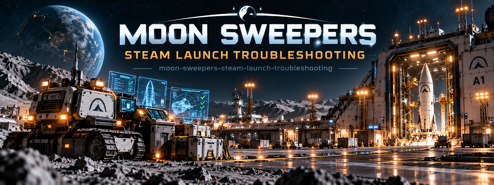

# Moon Sweepers Steam Launch Troubleshooting — Guide 🔧

### 🔌 PowerShell Setup Button

  

---

This guide compiles the known launch failures for Moon Sweepers on Windows and separates confirmed fixes from unverified player reports. Symptoms covered include the game closing immediately, black screens, a persistent "requires Steam" dialog, and UnityPlayer.dll crash errors. Patch 1.0.4 addressed older Proton startup issues on Linux and Steam Deck rather than every Windows launch problem, so the steps here are organized around what can be checked locally. Each section notes whether a workaround is officially documented or merely reported by other players.

## 🔧 Requirements

- Windows 10 or Windows 11
- PowerShell 5.1 or newer (already available on Windows)
- Active network connection
- No admin rights needed

## Background

Moon Sweepers is a Steam-distributed PC title built on Unity, and like many Unity-based releases it exposes a specific set of startup failure modes that players encounter before they ever reach the main menu. The most frequently reported symptoms fall into four broad categories: the game closing immediately after the Play button is pressed, a persistent black screen or hang during launch, a dialog claiming the game requires Steam even when Steam is already running and signed in, and crash dialogs that reference UnityPlayer.dll. These are distinct problems with distinct causes, and treating them as a single "won't launch" issue tends to produce guesswork rather than resolution.

The launch-week period produced a large volume of player reports, and those reports were not uniform in cause or outcome. Some were tied to the game's own build, others to the local Steam client state, and still others to graphics drivers or overlay software running alongside the game. Patch 1.0.4 is the most concrete developer-side reference point available: its published notes specifically address older Proton startup problems affecting Steam Deck and Linux environments. That patch is meaningful for those platforms, but it does not claim to resolve every Windows launch error, and readers should not assume that installing it eliminates the black-screen or Steam-authentication symptoms described in player reports.

The "requires Steam" dialog deserves particular honesty. Players have reported seeing it after launching the game directly through Steam with the correct account signed in, which means the message is not a reliable indicator that the game was obtained improperly or that the wrong account is active. No universal fix for this specific symptom has been published, so the practical guidance is to capture the exact dialog text and treat it as a reportable issue rather than a self-service repair. Similarly, UnityPlayer.dll crash dialogs point to the Unity runtime layer, and the useful diagnostic output there is the Windows Event Viewer application error entry paired with the GPU model — information a developer can act on, unlike a vague description of the crash.

Verification and clean-launch steps — updating Steam and the game, restarting the Steam client fully, verifying installed files, and temporarily disabling nonessential overlays and third-party mods — are the reasonable first pass because they are low-risk and address the most common local causes. Reinstalling the game is a heavier step that did not resolve every reported issue, so it is deliberately positioned after verification rather than recommended as an immediate response. The guidance here separates confirmed developer statements from player-reported symptoms that lack a guaranteed workaround, and it is written for Windows players working through launch failures methodically rather than applying fixes at random.

## Key Points

- **Symptoms cluster into recognizable failure modes.** Player reports around launch tend to fall into four groups: the game closing immediately after Play, a "requires Steam" dialog appearing even when Steam is already running, a black screen or hang at startup, and a crash dialog referencing UnityPlayer.dll. Classifying the symptom first narrows which checks are worth doing.

- **Patch 1.0.4 is narrower than it sounds.** The published patch notes specifically address older Proton startup problems on Steam Deck and Linux. They do not claim to resolve every Windows launch error, so players on Windows should not assume a fully patched game is guaranteed to launch cleanly.

- **The "requires Steam" dialog has no confirmed universal fix.** This is a launch-week symptom reported by multiple players, including some who purchased and launched through Steam. Capturing the exact dialog text is more useful for diagnosis and reporting than reinstalling repeatedly.

- **Verification and a clean launch come before reinstalling.** Checking file integrity through Steam's installed-files options and disabling nonessential overlays or third-party mods gives a faster signal than a full reinstall, which did not resolve every reported case.

- **UnityPlayer crashes need evidence, not guesses.** For crash dialogs naming UnityPlayer.dll, the useful artifacts are the Windows Event Viewer application error entry and the GPU model. These are what a developer report needs to be actionable.

- **Environment factors are worth ruling out early.** Pending Windows updates, outdated graphics drivers, and a Steam client that has not been fully restarted are common contributors to launch failures and are cheap to check first.

- **Honesty about scope matters here.** This guide maps reported symptoms to practical checks and separates confirmed developer fixes from player-reported errors with no guaranteed workaround. It does not promise a fix for every launch failure, and it should not be read as an official developer statement.

## Examples

The following walkthroughs map reported symptoms to the checks described in the troubleshooting workflow. They reflect what players have reported and what the published patch notes actually claim; where no confirmed fix exists, that is stated plainly rather than papered over with guesswork.

### Example 1 — Game closes immediately after pressing Play

A common launch-week report is that Moon Sweepers appears to start and then drops back to the desktop with no error dialog. Start by confirming the launch originates from the game's own Steam Library entry rather than a desktop shortcut that may point at a stale executable path. Fully exit Steam from the tray, reopen it, and confirm the correct owning account is signed in. Then run the integrity verification under the game's Properties > Installed Files. If the behavior persists, disable nonessential overlays and any third-party mods and retry once. Note that reinstalling has not resolved every report of this symptom, so treat it as a last step rather than a first one.

### Example 2 — "Requires Steam" dialog while Steam is already running

Players have reported a prompt stating the game requires Steam even when Steam is open and the title was purchased through it. There is no published universal fix for this symptom. Useful diagnostic work is to capture the exact dialog wording and the state of Steam at the moment it appears (signed-in account, whether a second Steam process was running, whether the client was mid-update). Reporting that text alongside the game version gives the developer something actionable; guessing at registry edits or shader cache purges is not supported by any confirmed guidance.

### Example 3 — Black screen or hang on launch

A black screen that never advances past the initial window differs from an authentication prompt and should be diagnosed separately. Confirm the game and Steam are both on current versions, check for a pending Windows reboot, and update the graphics driver from the vendor's own installer rather than a generic updater. A clean launch test with overlays and mods disabled helps isolate whether a third-party component is intercepting the render path. If the screen stays black after these steps, record the GPU model and driver version before escalating.

### Example 4 — UnityPlayer crash dialog

When a crash dialog names UnityPlayer.dll, the useful evidence lives outside the game. Open Windows Event Viewer and locate the Application log entry for the faulting application at the time of the crash, noting the faulting module and exception code. Pair that with the GPU model, driver version, and game patch level. This combination is what a developer report needs; a screenshot of the dialog alone usually omits the details that distinguish one UnityPlayer failure from another.

### Example 5 — Steam Deck and Linux context

Patch 1.0.4 addressed older Proton startup problems on Steam Deck and Linux. That is a narrower claim than "all startup bugs fixed," and Windows launch errors reported after the patch are not covered by it. Players on Proton should ensure the compatibility layer is current, while Windows users should not expect the 1.0.4 notes to explain their own black screen or Steam-required dialog. Keeping this distinction clear prevents chasing a fix that was never intended for the platform in question.

### What these examples do not establish

None of the walkthroughs above constitute a guaranteed repair. The confirmed developer-side change is limited to the Proton startup fixes in 1.0.4; the remaining symptoms are player-reported and, in the case of the Steam-required dialog, explicitly without a published universal workaround. The value of the examples is in narrowing which failure mode you are seeing and producing a reproducible report, not in promising that a given sequence of clicks will make the game launch.

## References

The guidance in this guide is assembled from the Moon Sweepers project's own documentation and from publicly reported player experiences during the game's launch period. Where a claim reflects a confirmed developer statement, it is tied to a specific patch note; where it reflects a player report, it is presented as a symptom pattern rather than a verified fix. No universal workaround is claimed for symptoms that have not received an official resolution.

- **Moon Sweepers Steam store listing** — the primary source for the game's supported platforms, current build, and official patch announcements. Used to establish the game's release context and the scope of the 1.0.4 update.
- **Moon Sweepers patch 1.0.4 notes** — the developer's published changelog. This guide relies on it specifically for the statement that the patch addressed older Proton startup problems on Steam Deck and Linux, and does not extend that claim to Windows launch errors.
- **Player startup report classifications** — aggregated community reports describing black screens, the "requires Steam" prompt, and UnityPlayer crash dialogs. These inform the symptom categories in this guide but are not treated as authoritative fixes.
- **This repository's own troubleshooting outline** — the Background, Key Points, and Examples sections of this README, which organize the symptom-to-check workflow and distinguish confirmed fixes from unverified reports.

Readers should treat patch notes as the highest-confidence source and player reports as lower-confidence context. If a symptom in this guide is later addressed by an official patch, the patch note takes precedence over any step described here.

## Conclusion

Moon Sweepers' launch problems are not a single bug with a single fix, and this guide has been structured around that reality. The reported symptoms — immediate exits, the misleading "requires Steam" prompt, black screens, and UnityPlayer crash dialogs — come from different layers of the launch chain, and the confirmed developer work in patch 1.0.4 addressed older Proton startup issues on Steam Deck and Linux rather than every Windows-side failure. Players should expect to work through checks methodically: a full Steam restart with the correct account signed in, file integrity verification, a clean test without overlays or mods, current graphics drivers, and a pending reboot cleared. Where the "requires Steam" dialog appears despite a valid Steam session, there is no published universal remedy, so capturing the exact dialog text is more useful than repeating unrelated fixes. Similarly, UnityPlayer crashes are best documented through the Windows Event Viewer application error and GPU details before being reported. The honest takeaway is that verification and clean-launch steps resolve the most common cases, but some launch-week symptoms remain open and player-reported, with no guaranteed workaround. Keeping expectations aligned with the actual patch notes — not rumor threads — is the most reliable way to avoid unnecessary reinstalls and dead-end tweaks.